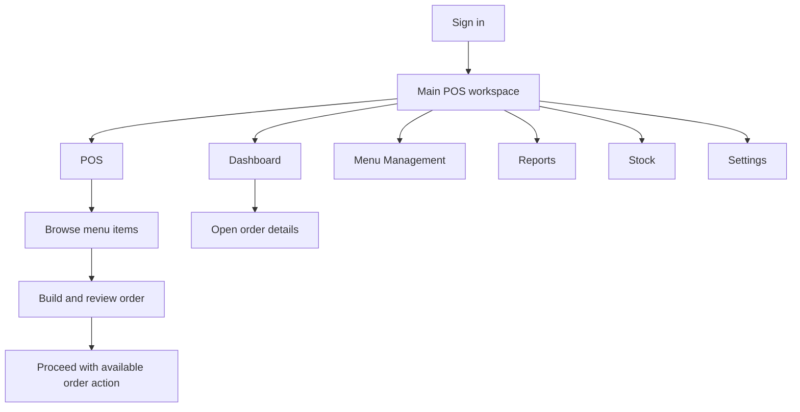
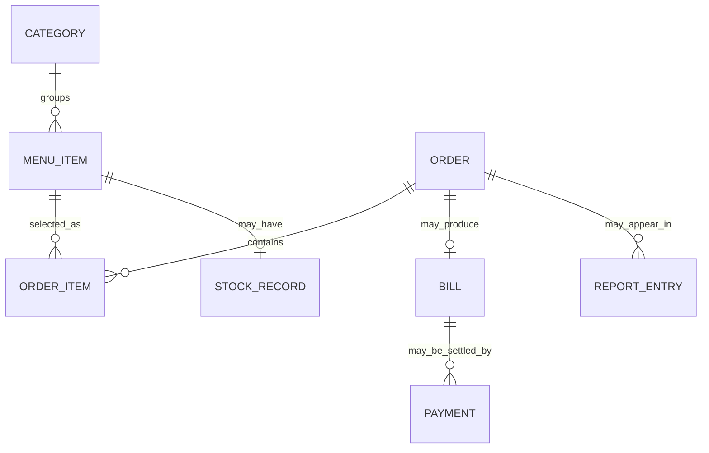
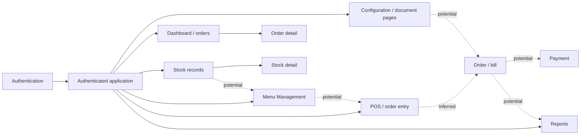

# aios.md — Restaurant POS Functional Specification

> **Purpose:** Evidence-based functional documentation of the restaurant POS application represented in the supplied screenshot montage. This document describes the visible product structure and cautious workflow interpretations. It is not a redesign specification or a technical implementation plan.

## Evidence and confidence conventions

- **Confirmed** — directly visible in the supplied screens or readable interface labels.
- **Inferred** — a reasonable interpretation of the visible UI, but the screenshot does not prove the underlying behavior.
- **Unknown** — not determinable from the supplied screenshots.

The source is a montage of 26 small screenshots. Some labels and field values are too small to read reliably. Where a label is not legible, this document describes the visible control or purpose rather than inventing its exact name. The montage shows interface states, not backend behavior, API contracts, or database design.

## Table of contents

1. [Application overview](#1-application-overview)
2. [Roles and permissions](#2-roles-and-permissions)
3. [Navigation and information architecture](#3-navigation-and-information-architecture)
4. [Module documentation](#4-module-documentation)
5. [User workflows](#5-user-workflows)
6. [Core business logic](#6-core-business-logic)
7. [Order and billing lifecycle](#7-order-and-billing-lifecycle)
8. [Inventory and stock management](#8-inventory-and-stock-management)
9. [Payments and financial operations](#9-payments-and-financial-operations)
10. [Reports and analytics](#10-reports-and-analytics)
11. [Forms, dialogs, and interactive behavior](#11-forms-dialogs-and-interactive-behavior)
12. [Conceptual data entities and relationships](#12-conceptual-data-entities-and-relationships)
13. [Validation and error handling](#13-validation-and-error-handling)
14. [System states and conditional logic](#14-system-states-and-conditional-logic)
15. [Module dependencies](#15-module-dependencies)
16. [Functional gaps and clarification list](#16-functional-gaps-and-clarification-list)

---

## 1. Application overview

### 1.1 Purpose

**Confirmed:** The interface is a web-based restaurant point-of-sale (POS) application. It provides a central workspace for restaurant operations, with visible areas for order handling, menu/product selection, financial summaries, stock-related records, reporting, and configuration or business information.

### 1.2 Target business and operating context

- **Confirmed:** Restaurant-oriented product catalog and food imagery are visible.
- **Confirmed:** Currency values are displayed using the Indian rupee symbol (₹).
- **Inferred:** The application is intended for staff working at a restaurant counter or back office.
- **Unknown:** Whether the product supports multiple outlets, multiple terminals, offline operation, or multiple legal entities.

### 1.3 Primary operational objectives

1. Review current sales/order activity.
2. Create orders in POS using menu items maintained through Menu Management.
3. Review order records and related details.
4. Monitor business totals and operational counts.
5. Maintain or inspect product/stock records.
6. Review financial or operational reports.
7. Maintain business or application configuration.

### 1.4 Visible application areas

| Area | Evidence | Confidence |
|---|---|---|
| Login | A standalone sign-in screen is shown | Confirmed |
| Dashboard | Summary cards show a rupee total, order count, and active count; order cards/listing are visible | Confirmed |
| POS | Category controls, food-item cards, and a current order/bill panel are visible | Confirmed |
| Menu Management | Menu/product records appear in a listing with related forms, panels, and actions | Confirmed at screen level |
| Reports | Tabular records and summary totals are visible | Confirmed |
| Stock | Product rows, quantities/status-like values, and a detail/action panel are visible | Confirmed |
| Settings | Form-like configuration, a document preview, and information/content panels are visible | Confirmed at screen level |

### 1.5 Overall conceptual workflow

This diagram represents the visible application areas and plausible navigation relationships. It does not establish exact route names or prove that all transitions occur in this exact sequence.

---

## 2. Roles and permissions

### 2.1 Identifiable roles

**Unknown:** The screenshots do not provide a readable user-management screen, role selector, permission matrix, or clear role names. A login screen is visible, but it does not identify the role model.

| Role | Purpose | Accessible modules | Permissions | Evidence |
|---|---|---|---|---|
| Signed-in user | Uses the POS after authentication | Main application is visible after login | Exact actions and restrictions are unknown | Login screen and authenticated screens |
| Administrator / manager | Possible operator of configuration and reporting areas | Not verifiable | Not verifiable | Inferred only from the presence of configuration/reporting screens; do not treat as a confirmed role |

### 2.2 Permission documentation rules

- Do not assume that every signed-in user can access every sidebar item.
- Do not assume that financial, stock, deletion, or configuration actions require manager approval.
- The visible delete/confirmation-style dialogs do not identify who is authorized to confirm them.
- Role-based access control must be clarified from the running application or product owner.

---

## 3. Navigation and information architecture

### 3.1 Global layout

**Confirmed:** Most authenticated screens share a persistent dark left sidebar, a light main workspace, and a top header area. Orange is used for selected navigation items and primary actions.

### 3.2 Sidebar and page hierarchy

The application has six primary navigation destinations:

1. Dashboard
2. POS
3. Menu Management
4. Reports
5. Stock
6. Settings

| Navigation destination | Visible content | Purpose |
|---|---|---|
| Dashboard | Summary metrics and order cards/list | Review overall activity and current orders |
| POS | Food-item catalogue, category controls, and current order/bill panel | Select items and build an order |
| Menu Management | Menu/product listing with related forms, panels, and actions | Review and manage menu records |
| Reports | Summary values, tabular records, and date selection | Review business/reporting data |
| Stock | Product rows and stock-like status/quantity values | Review stock records |
| Settings | Configuration forms, document preview, and information/content panels | Review or maintain application/business settings |

**Confirmed:** These six destinations are represented in the application's sidebar. The exact names above follow the supplied clarification. The purpose descriptions are based on the visible screen content.

### 3.3 Navigation behavior

- **Confirmed:** The sidebar remains present across the authenticated screens in the montage.
- **Confirmed:** An orange highlight indicates the currently selected navigation entry.
- **Inferred:** Selecting a sidebar entry changes the main workspace to the corresponding module.
- **Unknown:** Exact route paths, nested navigation, browser history behavior, and whether the sidebar can collapse.

---

## 4. Module documentation

### 4.1 Authentication

**Purpose:** Allow a user to access the POS application.

- **Confirmed:** A standalone login screen is shown with a centered sign-in card, a brand/logo area, input controls, and a primary orange submit button.
- **Visible inputs:** At least two form-like input rows are present. Their exact labels and whether they represent username/email and password are not reliably readable.
- **Visible action:** A primary sign-in/submit action.
- **Expected outcome (inferred):** Valid credentials lead to the authenticated application workspace.
- **Unknown:** Password reset, remember-me, MFA, account creation, lockout, session expiry, and exact validation messages.

### 4.2 Dashboard / order overview

**Purpose:** Provide a high-level view of sales and current order activity.

- **Confirmed:** Summary cards display a monetary total, an order count, and an active-order count. One screenshot visibly shows values around `₹42,850.00`, `54 Orders`, and `4 Active`; treat these as sample screen data, not fixed business rules.
- **Confirmed:** Order-related cards or rows appear below the summary area. They contain compact item/order information and action affordances.
- **Confirmed:** A date/calendar popup is shown in one dashboard state.
- **Confirmed:** Selecting an order appears to open a right-side detail panel in another state.
- **Inferred:** The date control filters the dashboard's displayed period or records.
- **Inferred:** Order cards allow staff to inspect or act on an order.
- **Unknown:** Metric definitions, date-filter defaults, refresh frequency, sorting, pagination, and whether counts include cancelled/refunded orders.

**Inputs and controls visible or suggested**
- Date selection/calendar.
- Order cards/list entries.
- Per-order action controls.
- A right-side detail panel with information and action buttons.

### 4.3 Order detail and order management

**Purpose:** Inspect an individual order and perform available order-level actions.

- **Confirmed:** Several screenshots show a white right-side panel over the main order workspace.
- **Confirmed:** The panel contains structured order information, form-like sections or fields, and one or more action buttons.
- **Confirmed:** Confirmation-style dialogs appear over the order workspace, including a red/destructive-looking action in one state and a green/success-style message in another.
- **Inferred:** The panel is opened by selecting an order from the dashboard/list.
- **Inferred:** The destructive dialog may relate to cancellation or deletion; the exact operation is not legible and must not be assumed.
- **Unknown:** Exact order fields, order status names, edit permissions, cancellation rules, refund behavior, and whether the panel supports payment collection.

### 4.4 POS

**Purpose:** Provide the order-entry workspace where staff select menu items and build a customer's order.

- **Confirmed:** The POS screen contains category controls, food-item cards with photographs, and a current order/bill panel.
- **Confirmed:** Item cards show images and compact item text/price/action areas.
- **Confirmed:** The order/bill panel is positioned to the right of the item catalogue and contains order information and primary action controls.
- **Confirmed:** A modal/confirmation state is shown over the POS workspace.
- **Inferred:** Staff choose a category to browse the available items.
- **Inferred:** Selecting a menu item adds it to the current order/bill panel.
- **Inferred:** Staff review the selected items and displayed amount before proceeding with the next order action.
- **Inferred:** This is the operational ordering screen and follows the normal order flow: choose items, build/review the order, then proceed using the available order action.
- **Unknown:** Exact item modifiers, variants, add-ons, quantity controls, item notes, table selection, dine-in/takeaway modes, tax treatment, discounts, payment steps, and whether the order is saved immediately or at a later step.

**Visible information and controls**
- Food-item images and item cards.
- Category controls for browsing items.
- Item names and price-like values (small text not reliably readable).
- Current order/bill summary panel.
- Primary action controls near the bottom of the order panel.

### 4.5 Menu Management

**Purpose:** Provide a separate area for viewing and managing the restaurant's menu/product records. This is distinct from POS, which is used to select items and place/build orders.

- **Confirmed:** The screenshots show a menu/product-style listing with rows containing product thumbnails and multiple information columns.
- **Confirmed:** Related states show a form or side panel over the listing, plus dialog/confirmation states.
- **Inferred:** Users can open a menu record to inspect or edit its details.
- **Inferred:** The listing and form are used to maintain menu information that is subsequently available for selection in POS.
- **Unknown:** Exact editable fields, category creation, item creation/deletion, availability toggles, pricing rules, variants, add-ons, image upload, and whether changes take effect in POS immediately.

**Visible information and controls**
- Menu/product rows with thumbnails.
- Multiple item information columns.
- Form/side-panel controls associated with a selected record.
- Confirmation or feedback dialogs in related states.

### 4.6 Reports

**Purpose:** Display monetary summaries and transaction-like records.

- **Confirmed:** Multiple screens show a report-style table with rows and columns.
- **Confirmed:** Summary cards show three monetary values in one screen; OCR/visual reading suggests totals in the vicinity of `₹789,995`, `₹735,710`, and `₹54,285`. Exact labels and formatting are not reliably legible, so these are not assigned meanings.
- **Confirmed:** A date/calendar popup is visible in a report state.
- **Confirmed:** A secondary side panel or popup with filter/action fields is shown in related states.
- **Inferred:** The calendar changes the reporting period.
- **Inferred:** Summary cards aggregate values from the displayed transaction records.
- **Unknown:** Report taxonomy, exact column definitions, formulae, export formats, reconciliation rules, and whether the report is sales, payments, collections, or another financial view.

### 4.7 Stock

**Purpose:** Inspect product-level stock information.

- **Confirmed:** A dedicated screen displays a list/table of products with small product images or thumbnails, text fields, and colored status/value indicators.
- **Confirmed:** A side panel or popup can be opened from the listing and contains additional fields and action controls.
- **Inferred:** Rows represent products or stock items, and the colored values may communicate stock status or quantity state.
- **Unknown:** Whether the module supports stock receiving, manual adjustment, supplier purchase orders, batch tracking, expiry dates, low-stock thresholds, stock valuation, or automatic deduction after a sale.
- **Important:** The screenshots do not prove that sales automatically update inventory.

### 4.8 Settings

The final row of the montage contains three distinct screen types:

1. **Form-like page:** A long page with labeled sections and multiple input controls.
2. **Document preview page:** A two-column arrangement with form/detail areas and a receipt or invoice-like preview that includes a barcode/QR-like graphic.
3. **Information/content page:** A page with multiple bordered content sections and action controls.

**Confirmed:** These screens belong to the authenticated application and use the same sidebar/header shell.

**Unknown:** The exact setting categories and editable field meanings are not fully readable. The preview is document-like, but the screenshots do not establish the exact document type or printing workflow.

---

## 5. User workflows

### 5.1 Sign-in

1. User opens the application.
2. The login screen is displayed. **Confirmed**
3. User enters information in the visible input fields. **Confirmed**
4. User activates the primary sign-in button. **Confirmed**
5. Successful authentication is expected to open the main workspace. **Inferred**
6. Invalid-credential behavior and recovery paths are **Unknown**.

### 5.2 Review dashboard and open an order

1. User reaches the authenticated workspace.
2. Dashboard/order overview displays summary metrics and order cards/list. **Confirmed**
3. User may choose a date using the visible calendar control. **Confirmed**
4. User selects an order or its action area. **Inferred**
5. An order detail side panel is displayed. **Confirmed**
6. User reviews details and may select an available action. **Confirmed**
7. The result of each action is **Unknown** unless the visible confirmation state makes it clear.

### 5.3 Create an order in POS

1. User opens **POS** from the main navigation. **Confirmed**
2. POS displays category controls and available food-item cards. **Confirmed**
3. User chooses a category to browse the relevant items. **Confirmed control; filtering behavior inferred**
4. User selects the required food item(s). **Inferred**
5. Selected items are reflected in the current order/bill panel. **Inferred**
6. User reviews the order details and displayed amount. **Confirmed that the panel is visible**
7. User proceeds using the primary action in the order panel. **Confirmed that the action exists; exact result unknown**
8. Payment, receipt printing, and kitchen-ticket behavior are **Unknown** from the montage.

### 5.4 Manage menu records

1. User opens **Menu Management** from the main navigation. **Confirmed**
2. A menu/product listing is displayed. **Confirmed**
3. User opens a record or related action. **Inferred**
4. A form or side panel is displayed over the listing. **Confirmed**
5. User reviews or edits the available fields. **Inferred**
6. A confirmation or feedback dialog may appear during the interaction. **Confirmed that dialog states are shown; exact trigger unknown**
7. Exact save behavior and the effect of changes on POS are **Unknown**.

### 5.5 Review a report

1. User opens the report/transaction screen. **Confirmed**
2. Summary values and a table of records are displayed. **Confirmed**
3. User opens the calendar/date filter. **Confirmed**
4. User chooses a date or period. **Inferred**
5. The report is expected to update to the selected period. **Inferred**
6. Export and drill-down behavior are **Unknown**.

### 5.6 Inspect stock records

1. User opens the stock/inventory listing. **Confirmed**
2. Product rows and stock-like values/status indicators are displayed. **Confirmed**
3. User opens a row action or detail control. **Inferred**
4. A side panel/popup with additional fields appears. **Confirmed**
5. User may review or update fields using the panel controls. **Inferred**
6. Save behavior, validation, and impact on stock totals are **Unknown**.

### 5.7 Settings or document workflow

1. User navigates to one of the final configuration/document screens. **Confirmed**
2. User views or edits a multi-section form. **Confirmed at screen level**
3. A document-like preview is visible on a separate screen. **Confirmed**
4. User may use an action control to save, print, or apply configuration. **Inferred**
5. Exact purpose and resulting system behavior are **Unknown**.

---

## 6. Core business logic

The screenshots show values and controls, but do not expose enough detail to establish calculation rules. The following matrix separates visible evidence from unverified logic.

| Business rule area | What can be established | Status |
|---|---|---|
| Item pricing | Food-item cards show price-like values | Confirmed that prices are displayed; source and calculation are unknown |
| Quantity | No reliable quantity rule can be read from the montage | Unknown |
| Subtotal | A bill/order summary panel is visible | Inferred that selected items contribute to a total |
| Discount | No clear discount rule can be established | Unknown |
| Tax | A form/configuration-like page may contain settings, but labels are unreadable | Unknown |
| Additional charges | Not verifiable | Unknown |
| Payment calculation | No payment breakdown or method flow can be reliably identified | Unknown |
| Split/partial payment | Not shown clearly | Unknown |
| Refund | A destructive or confirmation dialog exists, but its action is not legible | Unknown |
| Order status | An active-order count is visible; individual status labels are too small to verify | Confirmed active count; status model unknown |
| Stock adjustment | Stock listing and detail controls are visible | Confirmed listing; adjustment logic unknown |
| Approval | No approver identity or approval rule is visible | Unknown |

Do not implement formulas such as `subtotal = quantity × unit price`, tax-inclusive pricing, discount order of operations, or payment balance calculations as confirmed requirements based only on these screenshots. Such formulas may be conventional, but they require product-owner confirmation.

---

## 7. Order and billing lifecycle

### 7.1 Visible lifecycle elements

- A menu/catalogue for food selection.
- An order/bill-like summary panel.
- An order overview with an active-order count.
- Order records/cards.
- An order detail side panel.
- Confirmation/success-style dialogs.

### 7.2 Conceptual lifecycle (partially inferred)

```mermaid
stateDiagram-v2
    [*] --> OrderBeingBuilt: item selection (inferred)
    OrderBeingBuilt --> OrderRecorded: primary action (unknown result)
    OrderRecorded --> Active: active count suggests active orders
    Active --> DetailReview: open order detail
    DetailReview --> Active: close panel / return
    Active --> Completed: transition not shown
    Active --> Cancelled: destructive action may exist; unverified
```

### 7.3 Lifecycle rules not established

- Whether an order is saved before or after payment.
- Whether the application distinguishes draft, placed, preparing, ready, served, paid, completed, and cancelled.
- Whether order edits are allowed after submission.
- Whether removing an item changes an already-issued bill.
- Whether a receipt is automatically generated.
- Whether a kitchen order ticket (KOT) is created or printed.
- Whether a customer, table, token, or waiter is required.
- Whether cancellations require a reason or manager approval.
- Whether refunds are supported and how they affect reports.

---

## 8. Inventory and stock management

### 8.1 Visible functionality

- A stock-like listing with product thumbnails and multiple data columns.
- Colored text/status indicators in rows.
- A detail/action panel associated with the listing.

### 8.2 Not established by the screenshots

| Capability | Status |
|---|---|
| Create/edit product | Unknown |
| Add stock / goods received | Unknown |
| Manual stock adjustment | Unknown |
| Automatic deduction on sale | Unknown |
| Low-stock threshold and alert | Unknown |
| Supplier management | Unknown |
| Purchase orders | Unknown |
| Batch and expiry tracking | Unknown |
| Stock transfer between outlets | Unknown |
| Inventory valuation | Unknown |
| Stock report/export | Unknown |

**Implementation caution:** Treat inventory as a visible product/stock record area only until the actual stock workflow is inspected. Do not assume that sales and inventory are synchronized.

---

## 9. Payments and financial operations

### 9.1 Visible evidence

- Currency amounts are displayed in dashboard and report summary areas.
- A bill/order summary panel is visible in the menu/order-entry screen.
- The document preview resembles a receipt or invoice, but its exact type and operational role are unverified.

### 9.2 Payment capabilities requiring verification

- Cash, card, UPI, wallet, or other payment methods.
- Payment method selection.
- Full versus partial payment.
- Split payment across multiple methods.
- Payment status and outstanding balance.
- Refund and reversal handling.
- Receipt printing or digital sharing.
- Tax, service charge, tip, and discount calculations.
- Cash drawer or shift reconciliation.

Do not infer supported payment methods from the currency symbol or the presence of a document preview.

### 9.3 Conceptual entities

An order, bill, and payment may be separate business concepts, but the screenshots do not establish their exact relationship. Confirm whether one order can have multiple bills, whether one bill can have multiple payments, and whether refunds are stored as separate transactions.

---

## 10. Reports and analytics

### 10.1 Visible reporting behavior

- Report-like tabular screens are present.
- Summary cards display multiple financial values.
- A calendar/date picker appears in a report screen.
- A side panel or popup exposes additional filter/action controls.

### 10.2 Report data

The montage does not make report titles or column labels sufficiently readable. Therefore, do not assign meanings to the three visible summary amounts. The table appears to contain transaction or business records, but exact row semantics are unknown.

### 10.3 Report capabilities to verify

- Report names and categories.
- Date range presets and custom date selection.
- Filters by payment method, order status, cashier, product, category, or outlet.
- Search, sort, pagination, and drill-down.
- CSV, Excel, or PDF export.
- Whether totals are gross sales, net sales, tax, paid amount, outstanding amount, or another measure.
- Whether cancelled/refunded transactions are included.

---

## 11. Forms, dialogs, and interactive behavior

| UI element | Trigger / context | Visible purpose | Expected result | Confidence |
|---|---|---|---|---|
| Login form | Application entry | Collect sign-in details | Authenticate user | Form confirmed; outcome inferred |
| Calendar/date picker | Dashboard and report views | Select a date or period | Filter displayed data | Control confirmed; filter effect inferred |
| Order detail side panel | Order workspace | Show selected order information and actions | Review or act on order | Panel confirmed |
| Order-related confirmation dialog | Order workspace | Confirm a potentially consequential action | Apply or cancel the action | Dialog confirmed; exact action unknown |
| Success-style message/dialog | Order workspace | Communicate a successful or completed action | Return to workspace or continue | Visual state confirmed; exact event unknown |
| Catalogue category controls | Menu/order-entry screen | Narrow visible items | Update item catalogue | Controls confirmed; filtering inferred |
| Product/item cards | Menu/order-entry screen | Display selectable food items | Add/select item | Cards confirmed; selection outcome inferred |
| Order/bill summary panel | Menu/order-entry screen | Display current order details and actions | Continue order workflow | Panel confirmed |
| Stock detail/action panel | Stock listing | Display additional record fields/actions | Review or update stock record | Panel confirmed; outcome unknown |
| Multi-section form | Final configuration-like screen | Enter or review settings/business details | Save/apply values | Form confirmed; exact purpose unknown |
| Document preview | Final-row middle screen | Preview a receipt/invoice-like document | Possibly print or configure document | Preview confirmed; workflow unknown |
| Content/information panels | Final-row right screen | Display grouped information and actions | Unknown | Screen confirmed; purpose unknown |

### 11.1 Dialog behavior

- Some screenshots show the underlying workspace dimmed while a white modal/panel is in front. **Confirmed**
- This indicates a modal or overlay interaction pattern. **Inferred**
- One dialog has a visually destructive red action; another has a green success-like treatment. **Confirmed visually**
- Exact button labels, keyboard behavior, click-outside behavior, and whether dialogs can be dismissed with Escape are **Unknown**.

---

## 12. Conceptual data entities and relationships

The following are conceptual entities suggested by visible UI elements. They are not database tables or a proposed schema.

| Conceptual entity | Evidence | Confidence |
|---|---|---|
| User/account | Login screen | Confirmed that authentication exists; user data model unknown |
| Product/menu item | Food catalogue cards and stock rows | Confirmed |
| Category | Category/filter controls in catalogue | Confirmed |
| Order | Order cards/list and active-order metric | Confirmed |
| Order line/item | Food selection and order summary | Inferred |
| Bill/receipt | Order summary and document-like preview | Inferred |
| Payment/transaction | Financial summary and transaction-like table | Inferred |
| Stock record | Stock listing and detail panel | Confirmed at UI level |
| Report | Report-like table and summary cards | Confirmed |
| Business/configuration record | Multi-section form | Inferred; exact entity unknown |

### 12.1 Conceptual relationship map

**Important:** This is a conceptual model for discussion, not a confirmed database relationship diagram. The screenshot evidence does not prove cardinality, persistence, or implementation details. In particular, the `BILL`, `PAYMENT`, and `REPORT_ENTRY` relationships need validation.

---

## 13. Validation and error handling

### 13.1 Visible evidence

- A login form implies that sign-in inputs are collected.
- Confirmation dialogs indicate that at least some actions may require explicit confirmation.
- A success-style message is visible in an order-related state.
- No readable field-level validation messages or complete error states can be extracted from the montage.

### 13.2 Rules not established

- Required versus optional fields.
- Email/phone/credential format validation.
- Numeric quantity and price limits.
- Duplicate order or item prevention.
- Stock availability validation.
- Negative quantity or price handling.
- Tax/discount validation.
- Permission-denied behavior.
- Network/offline error handling.
- Save failure and retry behavior.
- Audit trail and reason capture for destructive actions.

Mark all such rules as **Unknown** until inspected in the live application or supplied specifications.

---

## 14. System states and conditional logic

| State or condition | Visible evidence | Interpretation |
|---|---|---|
| Authenticated vs unauthenticated | Login screen and application shell | Authentication gate is inferred |
| Selected navigation item | Orange sidebar highlight | Current section indicator confirmed |
| Dashboard date selection | Calendar overlay | Date-based filtering likely; effect inferred |
| Order detail open/closed | Side panel shown over order workspace | Detail view state confirmed |
| Dialog open/closed | Dimmed background and foreground dialog | Modal state confirmed |
| Success feedback | Green-accented dialog/message | Success-like state confirmed |
| Catalogue category selection | Category controls and item cards | Filtered catalogue state inferred |
| Stock detail open/closed | Side panel/popup over listing | Detail state confirmed |

The screenshots do not establish role-dependent states, payment-dependent actions, stock-dependent item availability, or status-based action permissions.

---

## 15. Module dependencies

### 15.1 Confirmed or strongly suggested dependencies

| From | To | Relationship | Confidence |
|---|---|---|---|
| Authentication | Main workspace | Login precedes authenticated screens | Inferred |
| POS item catalogue | Current order/bill panel | Item selection appears associated with a current order panel | Inferred |
| Menu Management | POS | Menu records are likely made available for ordering in POS | Potential dependency; exact synchronization is unknown |
| Order listing | Order detail panel | Detail panel is shown in the order workspace | Strongly inferred |
| Stock listing | Stock detail panel | Detail panel is shown over the stock listing | Strongly inferred |
| Report screen | Date picker | Calendar is displayed in report context | Confirmed UI association |
| Dashboard | Order metrics | Summary counts/amounts appear on dashboard | Confirmed |

### 15.2 Potential dependencies requiring verification

- Menu item availability may depend on stock.
- Completed orders may contribute to sales reports.
- Payments may update order/bill status.
- Product edits may affect both menu catalogue and stock listing.
- Configuration settings may affect taxes, receipt layout, or business identity.
- User permissions may restrict cancellation, refunds, stock edits, or configuration access.

### 15.3 Dependency diagram

Solid arrows indicate visible navigation/context relationships or the authenticated shell. Dotted arrows indicate dependencies that are plausible but not proven.

---

## 16. Functional gaps and clarification list

The following information is required before this document can be treated as a complete functional specification.

### 16.1 Authentication and users
- What are the exact login fields?
- What user roles exist?
- Is there a user-management module?
- Which actions are role-restricted?

### 16.2 Dashboard and orders
- What are the exact KPI names and calculation definitions?
- What does the date filter control?
- What are the exact order statuses and transitions?
- What fields appear in order details?
- What do the order-level action buttons do?
- Is the red/destructive confirmation for cancel, delete, refund, or another action?

### 16.3 Menu and billing
- What are the exact catalogue categories and item fields?
- How are quantities changed?
- Are variants, modifiers, add-ons, notes, or item-level discounts supported?
- Is a customer, table, waiter, or order type required?
- What does the primary action in the bill panel do?
- Are bills saved before payment?
- Is there a KOT workflow?

### 16.4 Payments and receipts
- Which payment methods are supported?
- Are split and partial payments supported?
- How are refunds handled?
- What are the exact tax, discount, and charge rules?
- Is the document preview a customer receipt, tax invoice, or another document?
- Can the document be printed, downloaded, or shared?

### 16.5 Stock
- What do the stock columns and colored indicators mean?
- Can users add, edit, or adjust stock?
- Is stock deducted automatically when an order is completed?
- Are suppliers, purchase entries, batches, and expiry dates supported?

### 16.6 Reports
- What are the report names and exact metric definitions?
- What are the table columns?
- Which filters are available?
- Can users export reports?
- How are cancelled orders, refunds, taxes, and unpaid bills represented?

### 16.7 Configuration screens
- What are the exact names and purposes of the final three screens?
- Which fields are editable?
- What does each save/apply/preview action do?
- Are printer, tax, business profile, and receipt settings configured here?

### 16.8 Evidence needed to close gaps

To produce a verified specification, collect:
1. Full-resolution screenshots of each screen, including readable labels.
2. Screenshots of each dropdown, modal, and side panel in its open state.
3. Short recordings of order creation, item modification, payment, cancellation, and stock update.
4. A role/permission list from the product owner or application.
5. Any existing product documentation or business rules.

---

## Final evidence assessment

The screenshots establish the broad product shell and several important functional areas: sign-in, an order-focused dashboard, order detail overlays, a food-item catalogue with an order summary, report/transaction tables with date selection, stock-like product records, and configuration/document-oriented pages.

They do **not** establish the complete order lifecycle, payment methods, tax and discount formulas, KOT behavior, automatic inventory deduction, detailed user roles, or backend architecture. Those areas remain explicitly unverified and must be investigated before implementation or domain adaptation.

**Scope boundary:** This document describes the restaurant POS as shown. It does not specify bakery or sweets-shop adaptations.
